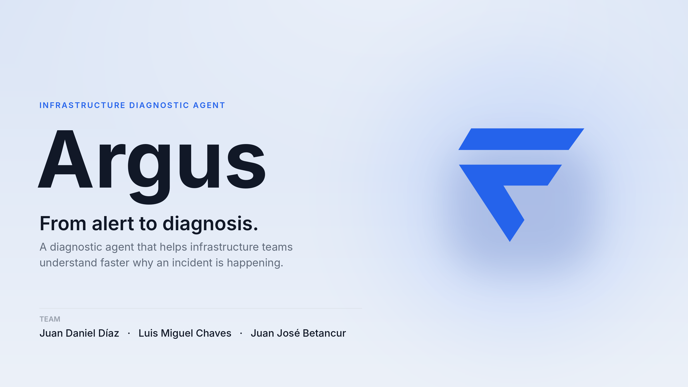
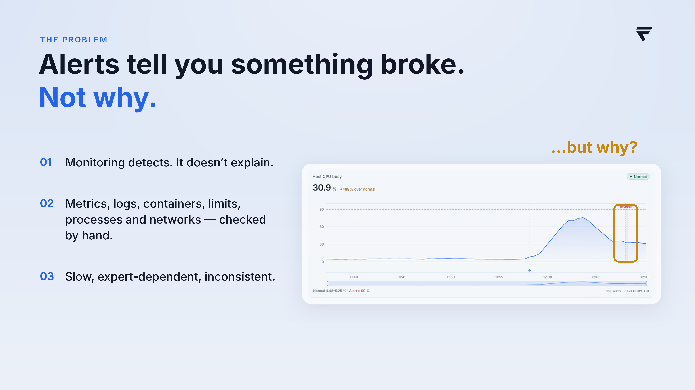
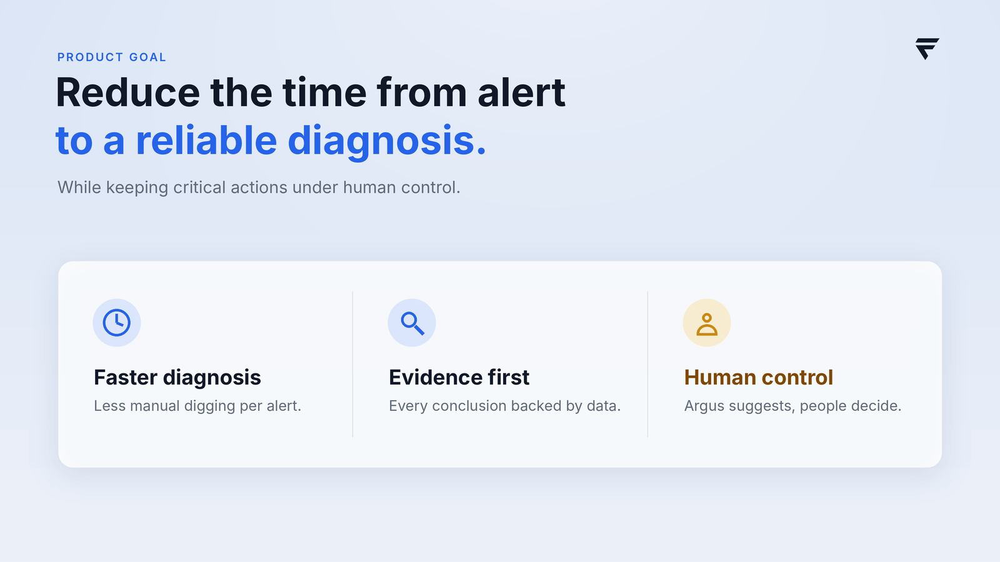
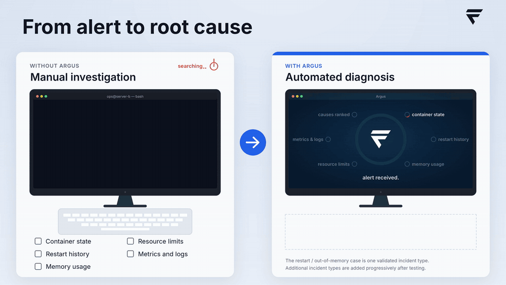
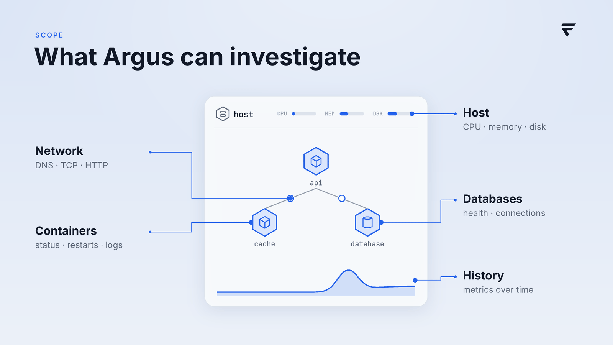
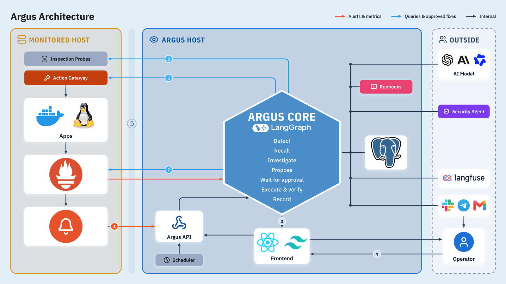
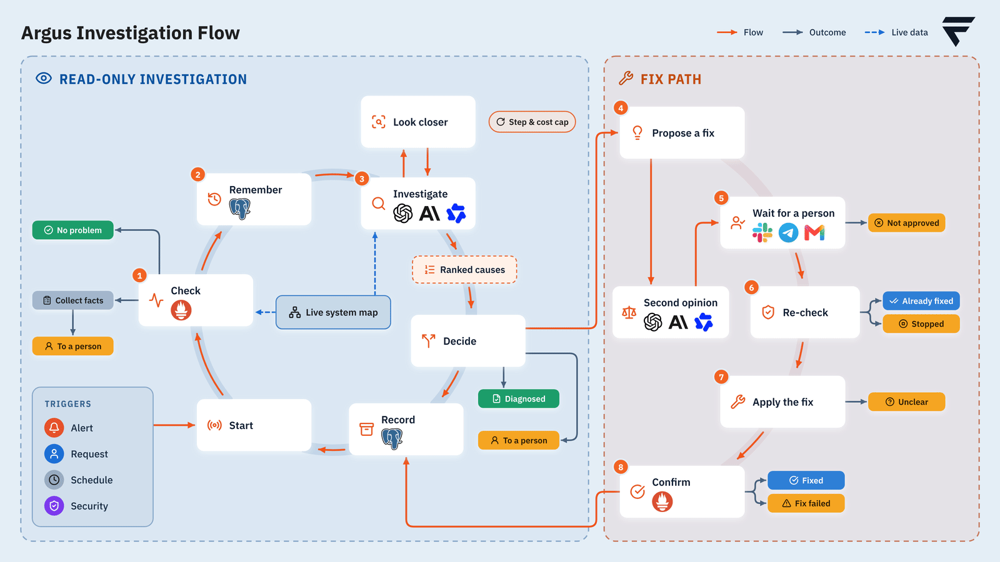
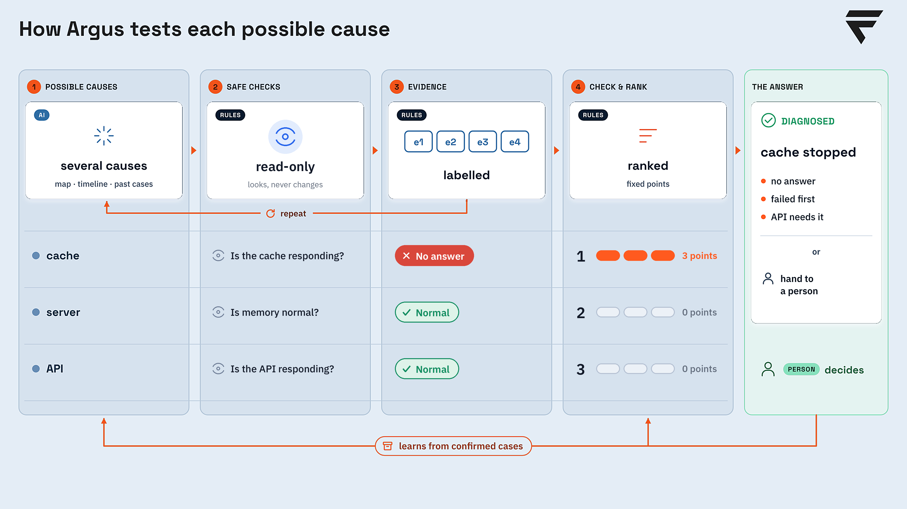
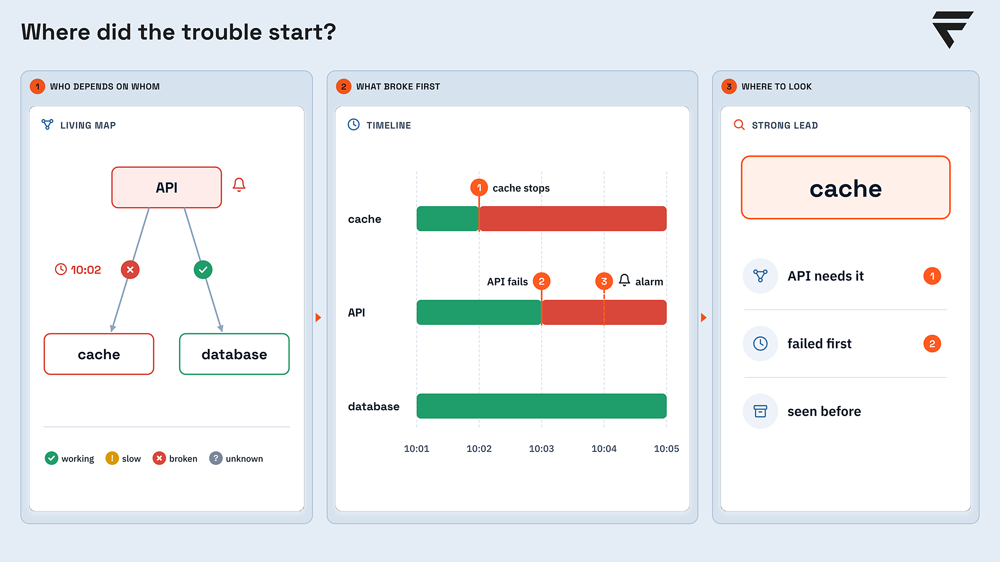

  

# Argus

**An infrastructure diagnostic agent: from alert to diagnosis.** Argus helps infrastructure teams understand faster
*why* an incident is happening. When an alert fires, a schedule ticks or an operator asks, it detects the symptom
deterministically, recalls runbooks and past cases, investigates with narrow, audited, read-only tools, and either
reaches a diagnosis backed by evidence or hands the case to a person. A fix is only ever **proposed**: a person
approves it, Argus applies it through a guarded path and then checks that it worked.

  
  
  

Team: Juan Daniel Díaz · Luis Miguel Chaves · Juan José Betancur.

## The problem

Alerts tell you something broke. Not why. Monitoring detects; it does not explain. Metrics, logs, containers, limits,
processes and networks are checked by hand, so diagnosis is slow, expert-dependent and inconsistent.

  

## The goal

> [!IMPORTANT]
> Reduce the time from alert to a reliable diagnosis, while keeping critical actions under human control.
> **Argus suggests, people decide.**

| | |
|---|---|
| **Faster diagnosis** | Less manual digging per alert. |
| **Evidence first** | Every conclusion is backed by data. |
| **Human control** | Argus suggests, people decide. |

  

## Argus at work

The same incident two ways: an operator digging by hand, and Argus going from the alert to the root cause. The
restart / out-of-memory case shown is one validated incident type; more types are added progressively after testing.

  

## What Argus can investigate

The host (CPU, memory, disk), containers (status, restarts, logs), the network (DNS, TCP, HTTP), databases (health,
connections) and history (metrics over time).

  

## How it works

### Architecture

Alerts and metrics flow from the **monitored host** (inspection probes, the action gateway, the apps, Prometheus and
Alertmanager) to the **Argus host**. **Argus Core**, a LangGraph state machine, runs *detect, recall, investigate,
propose, wait for approval, execute and verify, record*. The AI model, runbooks, the security agent, observability
(Langfuse) and notification channels sit outside; the operator works through the web frontend and the Argus API.

  

### Investigation flow

Two paths. The **read-only investigation** checks the symptom, remembers similar past cases, investigates with a step
and cost cap, ranks the causes and decides: no problem, diagnosed, or hand to a person. The **fix path** proposes a fix,
asks a second opinion from an independent model, waits for a person, re-checks that the problem is still there,
applies the fix, and confirms the outcome. Alerts, operator requests, schedules and security events can start a run.

  

### How each possible cause is tested

The model proposes several possible causes from the map, the timeline and past cases. Argus then runs safe, read-only
checks for each one, labels the evidence, and **ranks the causes with fixed points** (rules, not the model). The
answer is a diagnosis or a hand-off to a person, and confirmed cases improve the next run.

  

### Where did the trouble start?

Argus keeps a living map of who depends on whom and a timeline of what broke first. In the example, the cache stopped
first, the API fails because it needs the cache, and the alarm fires later on the API: the strong lead is the cache.

  

## Safety model

- **Read-only by default.** Investigations use narrow, audited tools; they look, they never change anything.
- **A fix is a proposal.** It is checked by a second opinion, held for a person, re-checked, applied through the action
  gateway on a released (capability, target) pair only, and verified afterwards.
- **People decide.** Approval needs an authenticated approver with a fresh second factor; a typed confirmation is never
  an approval.
- **Everything is recorded** in the audit trail and the incident history.

## Operator console

> [!NOTE]
> The console is **not a shell**: no pipes, no scripts, no arbitrary execution. Every command maps to one of Argus's own tools.

A restricted command console beside each incident: an operator types a fixed set of commands over Argus's own tools
(status, logs, metrics, network checks, and a few guarded write commands), and Argus comments on what each command
showed. Details, commands and limits:
[`docs/OPERATOR-CONSOLE.md`](docs/OPERATOR-CONSOLE.md); design: ACR-0043 in
[`brain/architecture/changes/`](brain/architecture/changes/).

*Evidence first. Human in control. Built to grow.*
